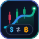

# OmniVest 📈

A real-time financial market monitor tracking **Forex, Shares (Stocks), and Crypto** assets, paired with live market news, interactive charts, and continuous updates.



---

## ✨ Features

- **Multi-Asset Monitoring**: Comprehensive tracking across Forex currency pairs, Shares, and Cryptocurrencies.
- **Continuous News Ticker**: Smooth, infinite horizontal market news feed with hover-to-pause and edge fade effects.
- **Detailed Article View**: Modal overlay for in-depth article reading without disrupting the dashboard flow.
- **Modern Fintech UI**: Built with Tailwind CSS v4, smooth animations, responsive cards, and clean typography.
- **Fast & Lightweight**: Powered by React 19 and Vite 8 for instant HMR and fast bundle times.

---

## 🛠️ Tech Stack

- **Frontend**: [React 19](https://react.dev/), [Vite](https://vite.dev/)
- **Styling**: [Tailwind CSS v4](https://tailwindcss.com/)
- **Data & APIs**: [Axios](https://axios-http.com/), Market data APIs (Twelve Data / Biquote)
- **Icons & Graphics**: Custom SVG asset branding & icons

---

## 🚀 Getting Started

### Prerequisites

- Node.js (v18 or higher recommended)
- npm, pnpm, or yarn

### Installation

1. **Clone the repository:**
   ```bash
   git clone https://github.com/l7afzoli9/omnivest.git
   cd omnivest
   ```

2. **Install dependencies:**
   ```bash
   npm install
   ```

3. **Configure environment variables:**
   Copy `.env.example` to `.env` and fill in your API keys:
   ```bash
   cp .env.example .env
   ```

4. **Start the development server:**
   ```bash
   npm run dev
   ```

5. Open [http://localhost:5173](http://localhost:5173) in your browser.

---

## 📁 Project Structure

```text
OmniVest/
├── public/
│   └── favicon.svg           # Custom Forex, Shares & Crypto favicon
├── src/
│   ├── assets/               # Static assets & graphics
│   ├── news/
│   │   ├── news.jsx          # Context provider & API data fetching
│   │   ├── newsCard.jsx      # Infinite animated news ticker
│   │   └── detailedNews.jsx  # Floating detailed article modal
│   ├── App.jsx               # Main application layout
│   ├── index.css             # Tailwind CSS & keyframe animations
│   └── main.jsx              # Application entry point
├── .env.example              # Environment variable template
├── index.html
├── package.json
└── vite.config.js
```

---

## 📜 Available Scripts

- `npm run dev`: Runs the app in development mode with HMR.
- `npm run build`: Builds the production-ready app into `dist/`.
- `npm run preview`: Locally previews the production build.
- `npm run lint`: Runs ESLint checks.

---

## 🤝 Contributing

Contributions, issues, and feature requests are welcome! Feel free to check the [issues page](https://github.com/l7afzoli9/omnivest/issues).

---

## 📄 License

This project is open source and available under the [MIT License](LICENSE).
